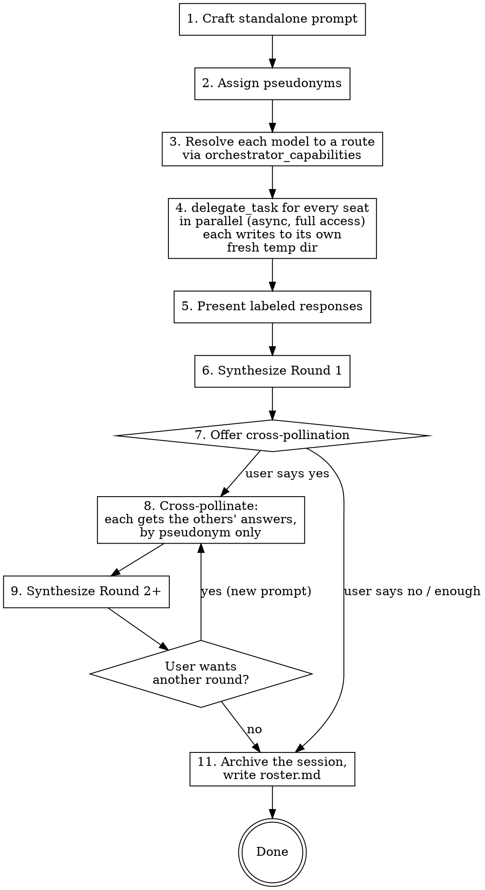

# The Gang (T3 Code)

Send the same prompt to a panel of models from different labs in parallel, using T3 Code's native `delegate_task`. Present every response, then synthesize. Optionally cross-pollinate: feed each model the others' responses to surface disagreements, blind spots, and deeper insights.

## When to Use

**Explicit triggers:** "ask the gang", "the gang", "what does the gang think". "The full gang" / "full panel" selects the full panel.

**Suggestive:** At significant decision points (architecture, strategy, tool choice), offer:
> "This seems like a good one for the gang - want me to ask them?"

Do NOT auto-invoke. Always let the user opt in.

## The Panels

The gang is defined by **models**, not providers. Which provider serves a model changes over time, so resolve the route at dispatch time (see step 2).

**Small panel (default):**

| Seat | Model |
|------|-------|
| OpenAI | GPT-6 Astra |
| Anthropic | Claude Opus 5.5 |
| xAI | Grok 4.6 |

**Full panel** (when the user asks for the full gang, or the decision is high-stakes enough to say so and offer it):

| Seat | Model |
|------|-------|
| OpenAI | GPT-6 Astra |
| Anthropic | Claude Opus 5.5 |
| xAI | Grok 4.6 |
| Meta | Muse Spark 1.3 |
| Zhipu | GLM 5.3 Flash |
| Google | Gemini 4 |

Use each model's default reasoning effort unless the user asks for something else.

## Flow



---

## Round 1: Independent Perspectives

### 1. Craft the Prompt

Distill conversation context into a **self-contained question** that makes sense without any prior history. Delegated agents see only the task prompt, never this conversation. If code or documents are needed, inline the relevant contents directly in the prompt.

Every seat gets the **exact same prompt**. No agent gets an information advantage. The only per-seat differences are the agent's pseudonym and its output file path (see step 3).

### 2. Assign Pseudonyms

**Pseudonyms.** Pick a fresh theme for each session and give every seat one name from it: the seven dwarfs, anime characters, birds, cars, rivers, cheeses, whatever you like. Assign names to seats in random order so a name never hints at a model. Rules for the theme:
- Every name in a session comes from the same theme, and no two names share an obvious trait (one bird of prey among songbirds stands out).
- Nothing that evokes a lab or model: no zodiac signs (Gemini), Greek muses (Muse), sun/moon/star names (Sol, Luna, Astra), musical terms (Opus), stories (Fable), or anything resembling Claude, Grok, GLM, Spark, and so on.
- Names must be safe as filenames: one word, ASCII, no spaces.

**Keep the mapping consistent.** Once assigned, a seat's pseudonym is fixed for the whole session: the same name in its prompt header, task title, `clientRequestId`, output filename, and every later round, both in its own prompt and in the other panelists' prompts. Never rename a seat between rounds, never reuse a name for a different seat, and never change theme mid-session. Before each dispatch, check that every name in the outgoing prompts points to the seat you intend.

Keep the pseudonym-to-model mapping in this thread only. It is written to disk only when the session closes (step 11), never while agents are running: they have full access and could read it.

### 3. Resolve Models to Routes

Call `orchestrator_capabilities` and find each panel model in the live catalog. Match on the model itself (family and version), not on a hardcoded provider or ID. Model IDs vary by route, e.g. Gemini 4 may appear as `opencode-go/gemini-4-argon-contributor` today and as something else under a different provider tomorrow.

Rules:
- Only consider providers with `canRunChildTask: true` (or `canRunCrossProviderChildTask: true` for providers other than the inherited one) and no blocking `constraints`.
- If a model is offered by several providers, prefer the model maker's first-party provider (e.g. Codex for GPT, Claude for Claude), then an aggregator such as OpenCode.
- Between variants of the same model on one route, prefer the paid one over a `-free` variant (free tiers tend to be rate-limited or logged).
- Do not substitute a different model for a seat (e.g. a different Grok version, or a Muse model other than Spark 1.3). If a seat's model is unavailable on every route, dispatch the rest and tell the user which seat is empty and why.

### 4. Dispatch in Parallel

Every seat runs with `runtimeMode: "full-access"`. Don't ask the user about permissions, and don't restrict the agents. Tell them in the prompt to go all in: read files, run commands, and research the web if it helps them answer.

**Give every seat its own temp directory, fresh for every round.** Agents have full access, so a shared output folder would let them read each other's answers. Before each round, create one directory per seat with plain `mktemp -d` (no prefix, so the directory is indistinguishable from any other temp dir) and keep the paths in this thread:

```bash
for p in Doc Grumpy Sleepy; do echo "$p $(mktemp -d)"; done
```

Each agent is told only its own directory. The answer file inside it is always named `answer.md`, so neither the path nor the filename carries a pseudonym or model. Never reuse a directory across rounds or seats, and never put anything else (the brief, other answers, the roster) in a seat's directory.

Wrap the shared prompt with a per-seat header and footer:

```
You are <Pseudonym>, one member of an anonymous panel of independent reviewers.

<the exact shared prompt>

---

Output rules:
- Write your complete answer as Markdown to <seat's temp dir>/answer.md.
  That file is your answer; it is what gets read, so put everything in it.
  Use that directory for any scratch work too.
- Do not reveal which model, company, or product you are, in the file or anywhere else.
  Refer to yourself only as <Pseudonym>.
- Your answer must be independent. Do not look for other panelists' work.
- When done, reply with just the path of your file.
```

Make one `delegate_task` call per seat, all in the same turn:

```json
{
  "task": "<wrapped prompt>",
  "title": "Gang R1 - <topic> - <Pseudonym>",
  "role": "review",
  "mode": "async",
  "runtimeMode": "full-access",
  "target": { "providerInstanceId": "<resolved provider>", "model": "<resolved model id>" },
  "clientRequestId": "gang-<topic-slug>-r1-<pseudonym>"
}
```

- Use `mode: "async"`, then end the turn. Each child's completion wakes this thread with its result; do not poll or spawn watchers. Use `task_status` only if a result is needed mid-turn.
- The task title uses the pseudonym, not the model, so nothing in the child thread's framing names the model.
- Keep every returned `taskId`, mapped to its seat and pseudonym.
- `clientRequestId` must be unique per seat per round and stable across retries of that same dispatch.
- Wait until every seat has reported (or failed) before presenting. Read each answer from its seat's `answer.md`. If a file is missing or empty, fall back to the task summary and say so. If a seat fails, report the error from its summary rather than silently dropping it.
- Use `task_cancel` if the user calls off a round.

### 5. Present Results

Read each answer from its file and show it raw. Anonymity applies only between panelists, not to the user, so label each response with pseudonym, model, and the route it ran on:

```
## Doc - Grok 4.6 (Grok)
[contents of Doc's round 1 answer.md]

## Grumpy - GPT-6 Astra (Codex)
[contents of Grumpy's round 1 answer.md]

## Sleepy - Claude Opus 5.5 (Claude)
[contents of Sleepy's round 1 answer.md]
```

### 6. Synthesize

After presenting all responses, add:

```
## Synthesis
- **Agreements:** [where the panel aligns]
- **Disagreements:** [where they differ, and why]
- **Recommendation:** [orchestrator's take, weighing all perspectives]
```

---

## Round 2+: Cross-Pollination

### 7. Offer Cross-Pollination

After Round 1 synthesis, offer:

> "Want me to feed each model the others' responses and have them battle it out?"

Only proceed if the user opts in. Cross-pollination is where the real value emerges - models challenge each other's assumptions, concede blind spots, and surface disagreements that the orchestrator's synthesis might miss.

### 8. Cross-Pollinate

Every round is a **new `delegate_task` call** per seat, with a new `clientRequestId` (`...-r2-<pseudonym>`, and so on). Never continue a round by sending to the child thread. Since children have no memory of earlier rounds, each new prompt must carry the original brief plus the context below.

**Panelists stay anonymous to each other.** They see each other only by pseudonym. Before pasting a response into another agent's prompt, scrub anything that gives away its author: self-identifying phrases ("as Claude", "OpenAI's guidance"), signature formatting a model is known for, or meta remarks about its own training. Change only what identifies the author; keep the substance intact. Never pass along the roster, model names, or routes.

Each panelist receives:
- The original prompt from Round 1
- Its own previous answer, labeled as its own
- Every other panelist's full previous answer, labeled only by pseudonym
- A structured set of questions forcing genuine engagement
- The same output rules as Round 1, pointing at a **new** temp directory created for this round

**Template for cross-pollination prompt:**

```
You are <Pseudonym>. You previously reviewed [TOPIC] as part of an anonymous panel. The original
brief is below, followed by your own earlier answer and the independent reviews of [N] other
panelists. You do not know who they are, and it does not matter: judge the arguments.
Read them carefully, then respond:

1. Where do you think they're right and you missed something?
2. Where do you think they're wrong or soft?
3. Where do they contradict each other, and who's right?
4. Does seeing their takes change YOUR overall assessment? If so, how?
5. What's the single most important thing that none of the reviews said clearly enough?

Be direct. Disagree where you disagree. Don't be diplomatic.

---

## ORIGINAL BRIEF:
[Round 1 prompt]

## YOUR EARLIER ANSWER (<Pseudonym>):
[its own previous response]

---

## <PSEUDONYM A>'S REVIEW:
[full scrubbed response]

---

## <PSEUDONYM B>'S REVIEW:
[full scrubbed response]

---

[Output rules, as in Round 1, with this round's new temp dir]
```

**Key rules:**
- Each panelist gets every other panelist's response; the set is symmetric
- Pseudonyms only. No model names, labs, or routes anywhere in the prompt
- The questions force concession ("where did they catch something you missed") and disagreement ("where are they wrong")
- "Don't be diplomatic" is load-bearing - without it, models default to "great points all around"
- Dispatch all seats in parallel (same as Round 1)
- With the full panel, prompts get long. That is fine; do not summarize other models' responses to save space

### 9. Synthesize Round 2

The Round 2 synthesis is richer than Round 1. Focus on:

```
## Round 2 Synthesis
- **Concessions:** What each model admitted it missed after seeing the others
- **Resolved debates:** Where models fought and one position won (note who and why)
- **Unresolved tensions:** Where they still disagree (these are the real decision points for the user)
- **New insights:** Things that only emerged from the cross-pollination, not present in any Round 1 response
```

### 10. Further Rounds (Optional)

The user can keep going. Common follow-up rounds:

- **"Now give me practical plans"** - shift the panel from critique to actionable strategy, carrying forward all prior context and criticisms
- **"Focus on [specific disagreement]"** - zoom into one unresolved tension
- **"Add the user's response"** - feed the user's reaction/pushback to the panel and have them engage with it

For each additional round:
1. Construct a new prompt that includes the original brief, all prior findings, the user's responses, and unresolved objections, plus the new instruction
2. Dispatch every seat in parallel with fresh `delegate_task` calls
3. Present and synthesize

There is no fixed number of rounds. Stop when the user has what they need or when returns are diminishing.

### 11. Close the Session

When the user is done with the gang, archive the session and clean up. Use the project's notes or scratch folder if it has one (the example below uses `scratchpad/gang/`), otherwise ask the user where to put it:

```
scratchpad/gang/<YYYY-MM-DD>-<topic-slug>/
  brief.md         # the Round 1 prompt
  r1/Doc.md        # copied from Doc's round 1 temp dir
  r1/Grumpy.md
  r1/Sleepy.md
  r2/Doc.md
  ...
  roster.md        # pseudonym, model, route, and taskId per round for each seat
```

Copy each seat's `answer.md` from its temp directory to `r<N>/<Pseudonym>.md`, double-checking each copy against the mapping. Then write `roster.md` and delete the temp directories. If the archive lives in a git repository, commit it.

---

## Common Mistakes

- **Hardcoding providers or model IDs.** Always resolve from `orchestrator_capabilities`. Routes change; the panel's models are what matter.
- **Silently substituting a model.** If a seat's model is missing, leave the seat empty and say so. A stand-in from a different lab or version is a different gang.
- **Giving agents different context.** All seats must get the identical prompt (Round 1) or symmetric context (Round 2+).
- **Assuming children remember.** Every delegated task starts fresh. Round 2+ prompts must carry the original brief and prior responses.
- **Continuing a round through the child thread.** Each round is a new `delegate_task` with its own `clientRequestId`; the `childThreadId` is storage only.
- **Polling.** Dispatch async and end the turn; completions wake this thread.
- **Holding the gang back.** Every seat runs with full access, with no permission question. Restricting tools only makes the answers worse.
- **Leaking identities between panelists.** Agents see each other only by pseudonym. Don't put model names in task titles, don't write `roster.md` before the last round, and scrub self-identifying text before passing a response along.
- **Breaking the mapping.** A pseudonym belongs to one seat for the whole session. Mixing up names between rounds silently corrupts the cross-review, so double-check names before every dispatch.
- **Sharing an output directory.** Each seat gets its own fresh `mktemp -d` directory every round. A shared or predictable path lets agents read each other's work.
- **Taking answers from the chat reply.** The file is the answer. Read the seat's `answer.md`; use the task summary only as a fallback, and say when you did.
- **Leaving models unstated to the user.** Anonymity is for the panelists, not the user. Label every response shown to the user with pseudonym, model, and route.
- **Running sequentially.** The whole point is parallel independent perspectives. Dispatch every seat in the same turn.
- **Summarizing instead of showing.** Show all raw responses first, then synthesize. The user wants to see the actual disagreements.
- **Being diplomatic in cross-pollination prompts.** If you don't explicitly tell models to disagree and be direct, they will default to "interesting points, I agree with most of this." The forcing questions (especially "where are they wrong?") are what make cross-pollination valuable.
- **Skipping the user's pushback.** If the user disagrees with something in the synthesis, feed that back to the panel in the next round. The user's perspective is data, not just a prompt.
- **Too many rounds without action.** Cross-pollination is powerful but can become its own procrastination trap. If the user has been through 3+ rounds of discussion, nudge toward execution: "The gang has spoken. Want to pick a direction and move?"
